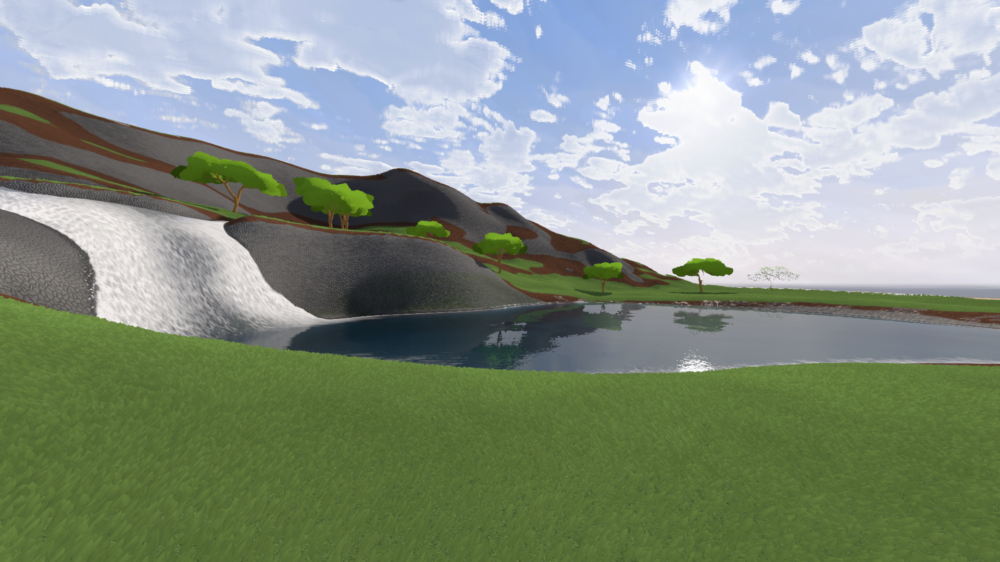
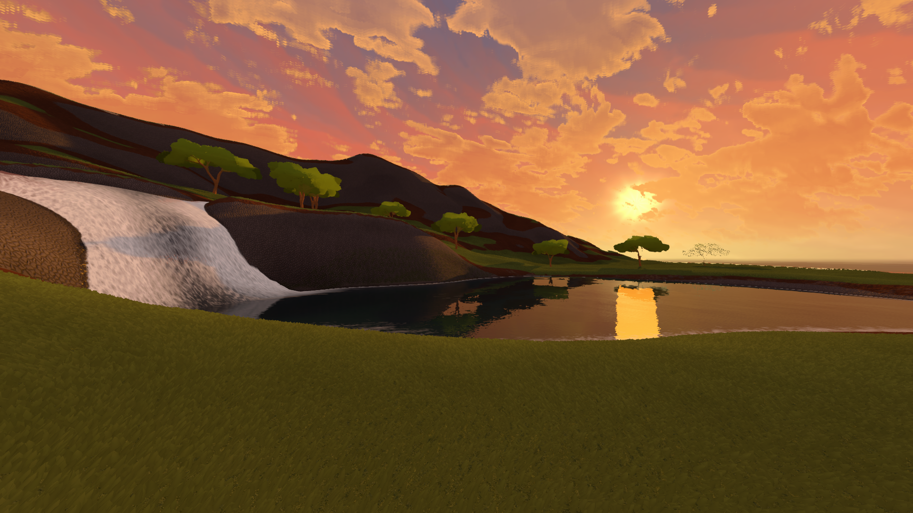
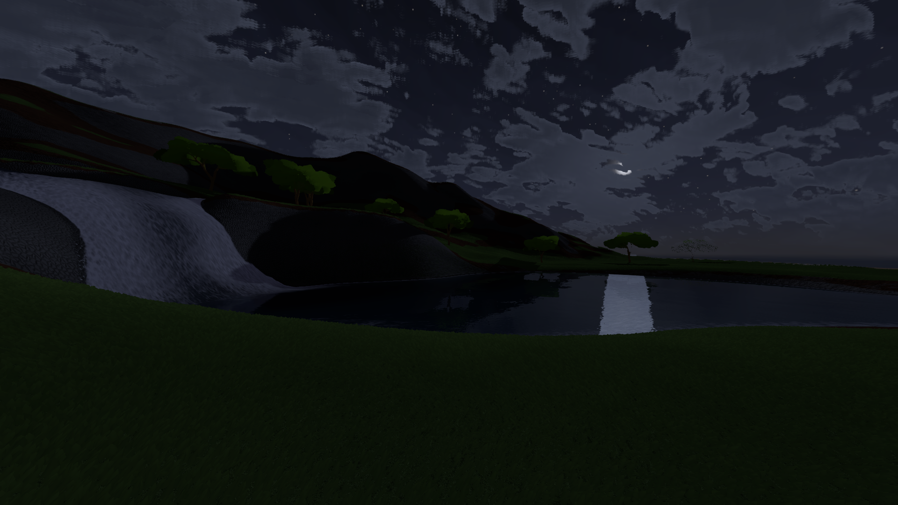
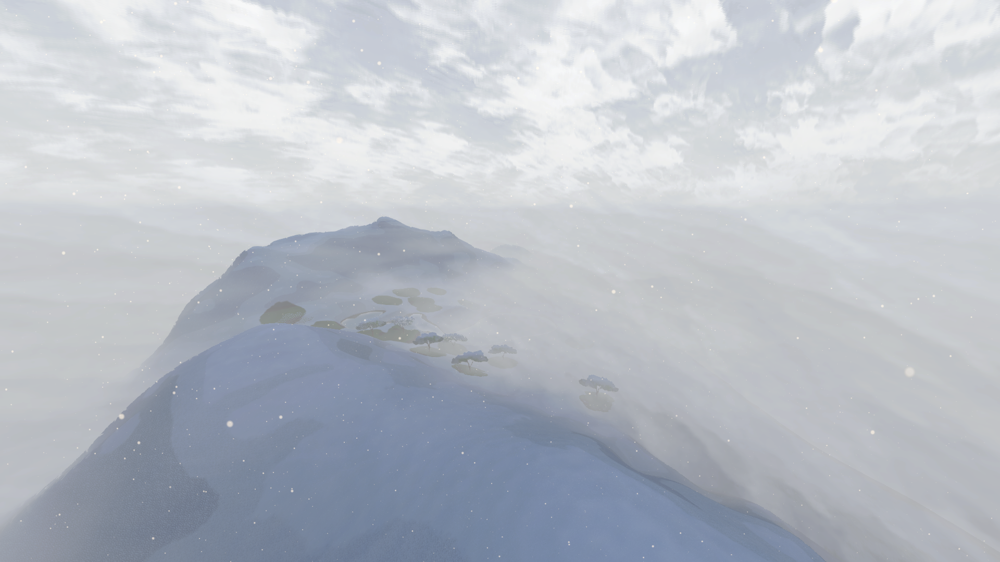
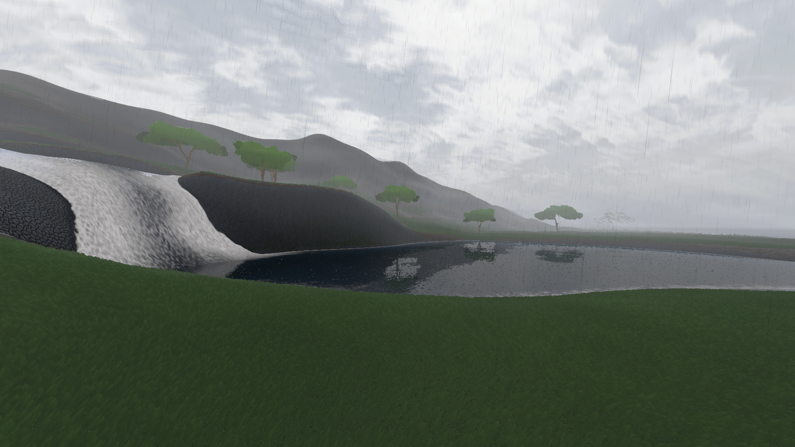
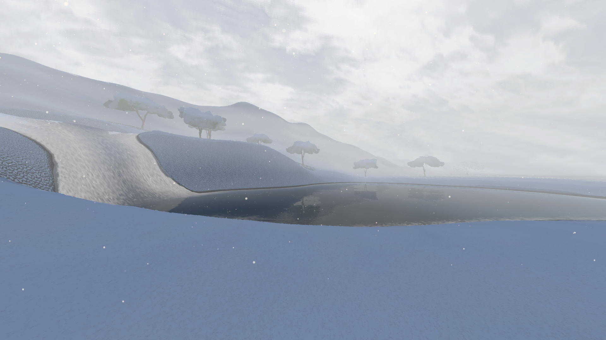

# Environment

The scene's sky, light, fog and weather come from two profiles and one component:

- the **Environment Profile** holds the look of the sky and the light;
- the **Atmosphere Profile** (in the Environment Profile's slot) holds the fog and how rain and snow look;
- the **HB Style Environment Controller** on the sun holds the scene's time of day and weather.

Every setting has a tooltip; this page explains how the parts work together.

| Day | Dusk | Night |
|---|---|---|
|  |  |  |

## Time of day

**Time Of Day** on the controller runs from 0 to 24. The sun rises at 6 and sets at 18; at night the same light is
turned to come from the moon. The Environment Profile has a Day, Dusk and Night version of most colours (sky,
ambient, fog), and blends between them by the sun's height: **Dusk Elevation** and **Night Elevation** on the
Light tab set where dusk and night begin.

The controller writes the Light's colour and intensity, so baked and realtime light always match the sky.

## Sky

| Tab | What it holds |
|---|---|
| Sky | Gradients of the sky by day, dusk and night, and the brush strokes painted over it |
| Light | Ambient gradients, the key light colour, moonlight |
| Sun & Moon | Discs, glow and rays |
| Night Sky | Stars and aurora |
| Clouds | The cloud atlas, coverage and cloud lighting |
| Brush | The brush atlas and stroke size shared by every shader of the package |

Clouds need a **cloud atlas**; make one in the [Texture Studio](Tools.md#texture-studio) (Cloud page). The brush
atlas comes from the Brush page of the same window.

## Fog

The Atmosphere Profile has three fog states, **Clear**, **Rain** and **Snow**, each a full set of fog settings.
The scene's fog blends between them by the controller's Rain and Snow, so a storm can bring in thick, grey,
close fog and clear weather can stay open. **Shared** holds what does not change with the weather: the painted
look of the fog and how much the wind clears it.

Each state has four groups:

- **Distance**: where the fog starts and how far you can see.
- **Layer**: fog that lies low. Below **Layer Top** the fog is even; above it, it fades out over **Fade Height**.
  **Layer Cover** decides how thick the layer looks from a mountain above it, and **Air Haze** keeps the horizon
  soft when you look out over the layer. Set Fade Height to 0 for fog that is the same at every height.
- **Colour**: fog colours by day, dusk and night, read along the view direction, and how much the fog takes the
  sun's colour.
- **Patches**: thick drifting patches with clearer gaps, moved by the wind.

Fog is drawn in one full-screen pass after the opaque objects, so it costs the same however many objects are on
screen. The sky, glass, liquids and falling rain apply the same fog themselves.

## Overcast

Rain and snow close the sky. **Cloud Response** on the Overcast tab sets how far: at 1 steady rain brings the sky
to full overcast. Under an overcast sky the sun's light fades away and its shadows go with it, while rooms and
shade stay dark, so no light leaks indoors. **Sky Grey** and **Fog Grey** drain the colour from the sky and fog;
**Baked To Sky** decides how far baked light gives way to the grey sky.

## Rain and snow

| Rain | Snow |
|---|---|
|  |  |

Set **Rain**, **Snow** and **Wind** on the controller, or use its preset buttons. From code, use
`HBStyleEnvironment.SetWeather` to change them over time (see [Scripting](Scripting.md)).

- **Falling rain and snow** are drawn around the camera, with a far layer filling the distance. They stop under
  roofs and behind glass. Their look (colour, width, flake size, opacity) is on the Precipitation tab.
- **Wet surfaces** darken and shine, with drops, ripples on flat ground and water running down steep faces.
- **Snow** settles on upward-facing surfaces in patches and melts back the same way.
- **Timing** is on the Surfaces tab: how long surfaces take to wet, dry, gather snow and melt. Outside Play mode
  the weather applies at once.

### Shelter

Anything above a surface keeps rain and snow off it: roofs, overhangs, trees, bridges. The package draws the scene
from above around the camera to find these covers, so interiors stay dry without any setup. **Roof Margin** on
the Surfaces tab spreads covers slightly outward to keep the strip just inside a wall dry.

When a roof is removed, the ground under it gets wet and snowy gradually, as if it had just started to fall
there. This suits games where players build and tear down houses.

Only Static HB surfaces and Foliage shelter. None and Moving surfaces, materials from other shaders and the
terrain itself never do.

### Weather on objects

| Component | Use it for |
|---|---|
| HB Style Weather Mask | An area that rain and snow should not reach without a roof: a campfire, a tent, the inside of a vehicle. Sphere is a dome; Box is a flat roof that follows the object. **Affects** picks Static surfaces, Moving surfaces or both. Can grow and shrink over time. |
| HB Style Weather Body | A Moving object that should wet and dry over time as it goes in and out of cover: a player, a vehicle. Add it to the root; it covers every renderer below it. |

Without a Weather Body, a Moving surface follows the cover of the spot it is in at once.

### Shores

Ground next to a liquid gets a wet band where the waves reach. **Shore Reach** and **Shore Darkening** on the
Surfaces tab set its width and how dark the ground under the liquid gets. It works in dry weather too.

## Zones

**HB Style Environment Zone** is a box that blends the camera toward another Environment Profile while the camera
is inside it: a cave, a swamp, a snowy pass. **Sections** chooses which parts of the profile the zone takes over;
the rest keeps following the scene. Zones fade in over **Blend Distance**, and higher **Priority** wins where zones
overlap.

Rain and snow are one state for the whole scene; a zone changes how the environment looks, not the weather.
