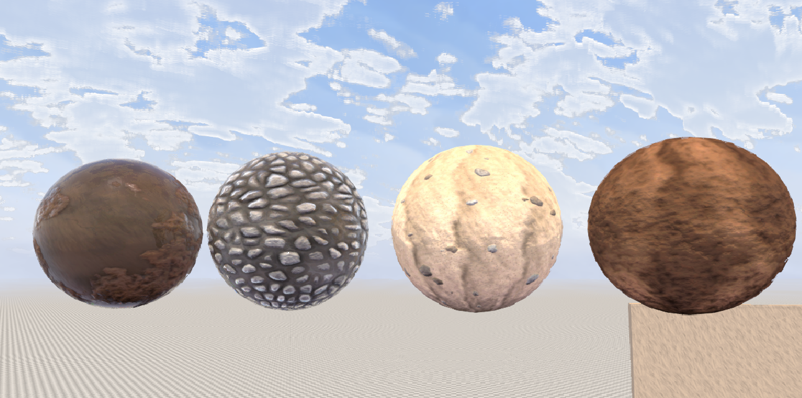

# Materials

Every shader of the package shares one lighting model and one brush, so objects drawn with different shaders sit
together in the same painted style. Each setting has a tooltip in the material inspector; this page explains what
each shader is for and the choices that matter.

| Shader | Use it for |
|---|---|
| HB URP Style/Lit | Every opaque object: buildings, props, rocks, characters |
| HB URP Style/Foliage | Leaves of trees and bushes |
| HB URP Style/Foliage Body | Trunks and branches |
| HB URP Style/Transparent | Glass, water in a bottle, ice, any see-through surface |
| HB URP Style/Particle | Particle systems |
| HB URP Style/Decal | URP Decal Projectors |

The Sky, Terrain and Terrain Liquid shaders are used by the package's own components; you do not assign them by
hand, except Sky on the skybox material.

## Lit

The inspector is split into sections. Sections with a toggle in their header cost nothing while they are off.

| Section | What it does |
|---|---|
| Surface | Colour, smoothness, metallic, alpha clip |
| Maps | Base, Normal and Mask maps; Triplanar mapping with its own Mapping Space |
| Shading | Diffuse wrap and softness, half tone, how the baked light is toned |
| Brush | The painterly strokes on the surface |
| Specular, Rim Light | Painted highlights and an edge light |
| Subsurface | Skin or Cloth light for characters |
| Emission | Glow |
| Weather | How the surface takes part in rain and snow |

**Maps** turn on by themselves when a texture is assigned. The Mask Map packs metallic (R), occlusion (G),
height (B) and smoothness (A); the [Texture Studio](Tools.md#texture-studio) writes this layout.

**Mapping Space** (for Triplanar and Brush): **World** for things that never move, **Object** for anything that
moves, **Rest Pose** for skinned characters, so the strokes stay on the body while it animates.

**Receive Weather** decides how rain and snow reach the surface:

| Mode | For | Behaviour |
|---|---|---|
| Static | Things that never move | Full wetness, puddle spots, running water, snow blanket. Shelters what is under it. |
| Moving | Vehicles, characters, anything that moves | Beaded drops and flakes. Never shelters anything. |
| None | Interiors, UI-like objects | Untouched by weather |

A building that players put up and tear down is Static; a vehicle is Moving. To make a Moving object wet and dry
over time as it goes in and out of cover, add **HB Style Weather Body** to its root (see
[Environment](Environment.md#weather-on-objects)).

## Foliage and Foliage Body

Use Foliage on leaf materials and Foliage Body on trunks. Add **HB Style Plant** to the plant's root and press
**Bake Plant**: it writes the canopy shape and wind into mesh copies and bakes the far billboard. Unbaked plants
draw without wind. Plants are drawn on the GPU with a billboard in the distance; see
[Terrain](Terrain.md#plants-and-trees) for placing them and their distance settings.

Foliage always takes weather as Static.

## Transparent

| Mode | Use it for |
|---|---|
| Alpha | Plain see-through surfaces |
| Premultiply | Textures whose colour already holds its alpha; dark parts stay see-through |
| Additive | Glow, light beams |
| Tinted | Coloured glass: filters what is behind it by colour |
| Refractive | Thick glass, ice, water: bends and blurs what is behind it |

Tinted and Refractive glass can cast **coloured shadows**. Rain is drawn correctly in front of and behind glass.
All transparents are drawn back to front, one surface at a time.

## Particle

Alpha, Premultiply or Additive, with flipbook blending and an optional lit mode that uses the style's lighting.

## Decal

Place it with a URP **Decal Projector**. The renderer needs URP's **Decal** feature with Technique **DBuffer** and
Surface Data **Albedo Normal MAOS**.

Decals land on Lit, Foliage, Foliage Body, the terrain and grass, and sit on top of snow. **Edge Wear** eats the
decal's border along the surface's brush strokes. **Affect Surface** gives a matte surface the decal's
smoothness, for example a wet paint mark.

## Shader Graph

Create a graph from *Assets → Create → Shader Graph → HB URP Style Graph*. It is a URP **Unlit**, **Opaque** graph
with the **HB Base** node wired to the outputs. Feed HB Base from the section nodes found under *HB URP Style* in
the node menu:

| Node | Same as Lit's |
|---|---|
| HB Maps | Maps, including Triplanar and Mapping Space |
| HB Brush | Brush |
| HB Specular, HB Rim Light | Specular, Rim Light |
| HB Subsurface | Subsurface |
| HB Emission | Emission |
| HB Weather (Static), HB Weather (Moving) | Weather |

Graphs use the same lighting, brush, decal and weather code as Lit. Map keywords turn on by themselves when a
texture reaches the node. On/off inputs are Boolean ports; to show one on the material, connect a property.

*HB URP Style Decal Graph* creates a URP Decal graph with the **HB Decal** node and its settings already exposed.

Graphs must be opaque. For see-through materials use HB URP Style/Transparent.
