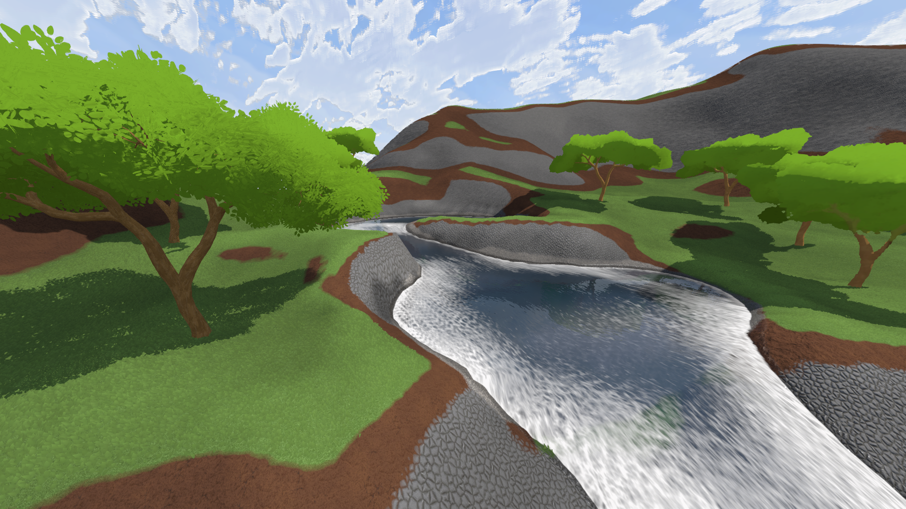
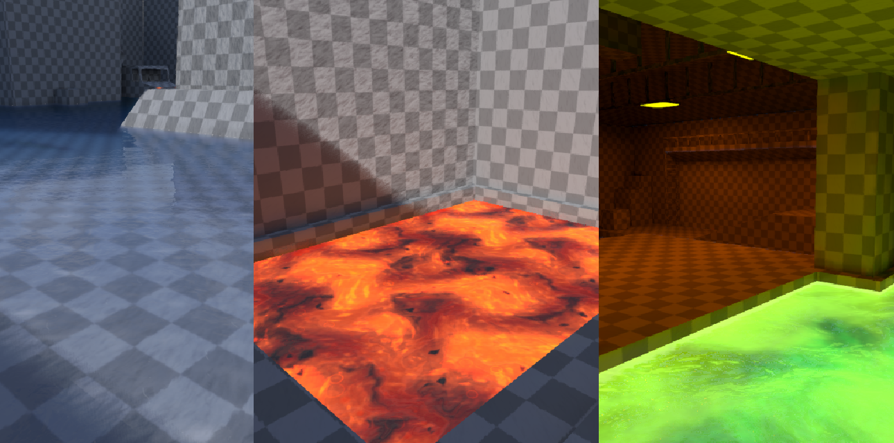

# Terrain

The package has its own terrain, built for the style: ground layers placed by rules, painted grass and flowers,
GPU-drawn plants and trees, and connected water, all edited from one inspector.

## HB Style Terrain

Create one from *GameObject → HiddenBull → HB Style Terrain* and press **New** on its inspector for a flat terrain.
The data lives in an **HB Style Terrain Data** asset. **Settings** can import the heights and holes of a Unity
terrain.

- One terrain is up to 4 × 4 km with a heightmap up to 4097², square only.
- Near the camera the terrain is drawn at full detail, so it matches its collider; detail drops with distance.
  The Terrain quality level sets how fast.
- Collisions use a regular Unity Terrain Collider, which the component fills.
- The terrain takes baked shadows but no baked light: each lighting Bake gives it a shadowmask at 2 texels per
  metre (up to Max Lightmap Size); grass, cards and flowers read it at their root. Rebake after moving static
  objects or the sun.
- The baked layer map, hand painting, grass painting and liquid maps are kept losslessly compressed in the data
  asset and unpacked when it loads. Hand painting stays in the Editor; it never goes into a build. Older data
  assets are converted the first time the project opens.
- Layer textures are not copied into the data asset: when the terrain loads, they are copied straight into GPU
  arrays. That needs, per map (albedo, normal, mask), square textures at least the Texture Resolution in size, with
  mipmaps, without mipmap streaming and with one compression format; normal and mask maps need sRGB off. The
  Layers tab warns about textures that do not fit and **Match Import Settings** fixes the import settings. Textures
  that do not fit still work, resampled at about four times the memory. A layer without a normal or mask map gets
  a flat normal and a mask made from its albedo.

The inspector has five tabs:

| Tab | What it does |
|---|---|
| Layers | Ground layers, their rules, the live preview and Bake |
| Brushes | Sculpt, holes, paint layers, grass and plants in the Scene view |
| Liquids | Liquid layers, the sea and the water brushes |
| Look | Brush strokes, curvature and colour variation of the ground |
| Settings | Map resolutions, heights, import |

## Ground layers

A layer is an **HB Style Terrain Layer** asset: its textures, tiling, tint, weather response and grass. An **HB
Style Terrain Layer Set** lists up to 16 layers from bottom to top: the first covers the whole terrain, each later
one covers the ones before it where its **rules** match (slope, height range) or where you paint it.

Changes show at once in a **live preview**. **Bake** writes the result into the terrain data; **Auto Bake** does it
by itself after each change. Hand painting survives a re-bake. *Assets → HiddenBull → Convert To HB Style Terrain
Layer* turns a Unity Terrain Layer into one.

Make layer textures in the [Texture Studio](Tools.md#texture-studio) (Material page).

## Sculpting and painting

The **Brushes** tab works in the Scene view. Size, strength and hardness are shared; `[` and `]` change the size.

- **Sculpt**: Raise (Shift lowers), Smooth, Flatten, Set Height, Noise, Terrace, Ramp.
- **Holes**: cut holes for cave entrances; Shift fills them. The collider gets the same holes.
- **Paint Layer**: paint a ground layer by hand.
- **Grass**: thicken, thin, raise or shorten the grass the layers give, or reset it.
- **Paint Plants**: place trees and bushes (see below).

## Grass and flowers

Each ground layer grows its own grass: density, height, width, curl, colour at the tip, and an optional share of
alpha-cut **cards** for taller plants. Grass takes its colour from the ground under it, so it always matches the
painted layers. **Flowers** grow in patches from a flower texture made in the Texture Studio.

Grass is generated on the GPU around the camera; the Grass quality level sets how far it reaches and how thick it
grows. It sways in the wind, gets wet and snowy with the ground, and is never drawn by overlay cameras.

| Component | Use it for |
|---|---|
| HB Style Bender | Presses grass and snow down around a player, an animal or a vehicle; leaves a trail. |
| HB Style Grass Clear | Removes grass inside a box or sphere: a house foundation, a road piece, a campfire. |

## Plants and trees

Any prefab with **HB Style Plant** on its root (see [Materials](Materials.md#foliage-and-foliage-body)) can be
painted on the terrain from **Paint Plants**: choose density, spacing, size range and rotation per plant, click
to place a single one. Shift erases every kind of plant under the brush; Ctrl + Shift erases only the
selected kind. Moving the ground with Sculpt moves the plants with it.

Plants are drawn on the GPU: the real mesh up close, a baked billboard further away, nothing past the cull
distance. Each plant asset sets three distances (for a 60° field of view; zooming in pushes them out):

| Distance | Default |
|---|---|
| Switch to billboard | 25 m |
| Cull | 300 m |
| Real mesh shadow | 20 m |

Plants hidden behind hills and buildings are skipped, but they still cast shadows.

**Colliders**: if the plant's prefab has Box, Sphere, Capsule or Mesh colliders, each painted plant gets copies in
Play mode, with an **HB Style Plant Body** component that names the plant. Each copy takes the layer and tag of the
GameObject that holds that collider in the prefab. Leave colliders off small plants and
prefer Capsule over Mesh. **Harvest** removes one plant at runtime; see [Scripting](Scripting.md#harvesting-plants).

## Liquids

Water, acid and lava are **HB Style Liquid Layer** assets. Make them on the Liquid page of the Texture Studio,
which starts from Water, Acid and Lava presets.

**Connected liquid** lives on the terrain: open the **Liquids** tab, add up to four layers, and paint.

- **Sea**: one level all around and beyond the terrain. Turn off **Sea Beyond Terrain** on maps where the far
  water is never seen; the liquid then ends at the terrain's edges and costs less.
- **Level brushes**: Raise, Set Height, Smooth, **Lake** (click a hollow to fill it, or draw a circle or square
  lake), **Ramp** for rivers, **No Liquid** for dry spots.
- **Flow brushes**: Flow, Smooth Flow, Auto Flow (downhill), Whirlpool.
- **Calm**: quiet the waves in a harbour or a pond.

**HB Style Liquid Pool** is a separate box of liquid that never joins the terrain's water: a well, a tank, a
cauldron. Scale the object to size it.

| Component | Use it for |
|---|---|
| HB Style Liquid Cutter | Keeps the inside of a Box, Sphere or Mesh dry: a boat hull, a tunnel under the sea. **Roof** also keeps rain out of it. |
| HB Style Liquid Trail | Leaves a foam wake and ripples behind anything moving through the surface. |
| HB Style Liquid Tester | Shows what a liquid query returns at a point or over a grid, for debugging floating objects. |

Underwater the camera gets tint, fog, light shafts, caustics and bubbles; the waterline matches the surface.
For floating objects and swimming, use the liquid queries in [Scripting](Scripting.md#liquid-queries).
