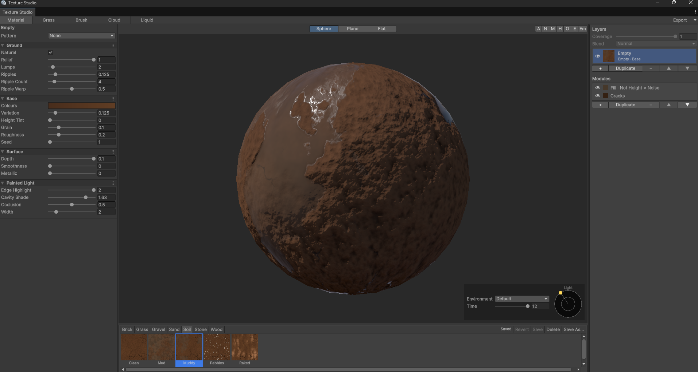
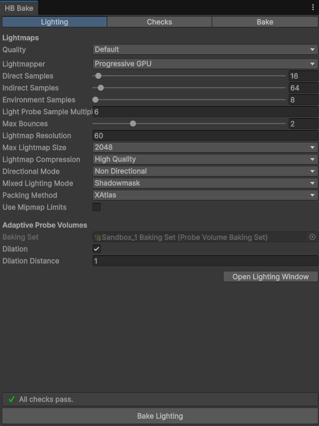

# Tools

All windows are under *Tools → HiddenBull → URP Style*.

## Texture Studio

Makes every texture the style needs, on the GPU, with a live preview in the real HB shaders. Every file it saves
is named `TEX_Words_Like_This`; liquid layers are saved as `LIQ_Name.asset`. Undo works on every page.

| Page | Makes |
|---|---|
| Material | Albedo, normal, mask and emission maps for Lit materials and terrain layers. A stack of layers, each with a pattern (Cells, Rows, Herringbone, Basket, Scatter) and modules such as Cracks, Scratches, Wood Grain, Chips and Leaves. Starts from a shelf of presets. |
| Grass | Grass card shapes and up to eight flower kinds for the terrain. |
| Brush | The brush atlas: Oil, Gouache, Dry Brush, Hatching or Watercolour strokes. |
| Cloud | The cloud atlas: Cumulus, Stratus, Cirrus, Altocumulus. |
| Liquid | A whole liquid layer: its look, plus a stack of layers (Waves, Flow, Cells, Rocks, ...) that bake its mask and normal maps. Starts from Water, Acid and Lava presets. |
| Mask | A mask map (R metallic, G occlusion, B height, A smoothness) from textures you already have. Each channel is a constant, a channel of another texture (Invert turns roughness into smoothness) or **Auto**: height, occlusion and smoothness estimated from the albedo, and the normal map if given. |

Use **Export** in the toolbar to choose the name, resolution and folder, then **Save**.

## Bake Panel

Sets up and runs lighting bakes for the style.

| Tab | What it does |
|---|---|
| Lighting | Bake quality from four presets (Potato, Low, Default, Ultra) or by hand |
| Checks | What the scene needs for the style's lighting, with a **Fix** button where one click can fix it |
| Bake | Bakes lightmaps and Adaptive Probe Volumes together, then reports time, lightmap count and size |

Red checks must pass before a bake; yellow ones are advice. The footer always shows the check summary and the
Bake and Cancel buttons.

- While a bake runs, fog and weather are held neutral and clouds keep the profile's Coverage, so the baked
  light is the same in any weather.
- **Use Mipmap Limits** off (the default) removes the lightmaps' mipmaps after every bake. This keeps distant
  lightmapped surfaces from bleeding into each other.

## Optimize Variants

Shortens player builds. Unity compiles every material once with and once without each shader keyword the
project keeps, so one keyword nothing uses can double the shader variants and the build time.

| Tab | What it does |
|---|---|
| Checks | Scans the build scenes and the project's prefabs and lists keywords that nothing uses: LOD Cross Fade, Light Cookies and BatchRendererGroup variants. **Fix** turns the setting off |
| Variants | How many variants each shader compiled in the last build and which keywords multiply them |

- The counts are taken during every player build. A build that reuses the shaders of an earlier build keeps
  the last counts; choose **Clean Build** to count again. Already compiled variants stay cached, so a Clean
  Build after a full build is fast.
- Cookies assigned from scripts at runtime are not seen by the scan.
- Variants for Subtractive lighting and for the full Shadowmask mode are left out of every build
  automatically while no Lighting Settings asset bakes Subtractive and no quality level uses Shadowmask Mode
  Shadowmask. The style uses Distance Shadowmask, which never needs them.

## Debug window

Shows what the renderer sees. Pick a **View** to replace the scene's colours with one quantity:

| Group | Views |
|---|---|
| Shadows | Cascades, filter values, blockers, search radius, unfiltered, attenuation, transparent tint |
| Weather | Shelter, wetness, snow, precipitation, moving bodies, gust |
| Atmosphere | Fog amount |
| Lighting | Ambient occlusion |
| Terrain | Layers, albedo, curvature, detail rings |
| Grass | Cells, density |
| Foliage | Canopy, sway |
| Liquid | Depth, flow, foam, waves, trails, underwater |
| Culling | What the game camera skips, seen from the Scene view |

The window also shows the shelter map from above, the number of falling drops and flakes, and the terrain's
patch count. Debug views exist only in the editor; they are stripped from builds.

## Terrain editing

Terrain tools have no window of their own: they are on the HB Style Terrain inspector and work in the Scene view.
See [Terrain](Terrain.md).
