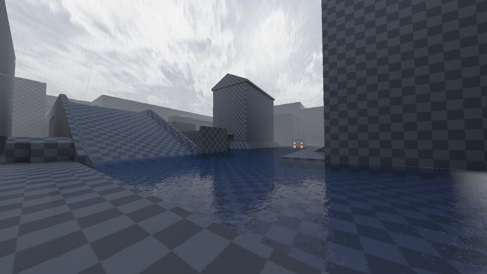

# HiddenBull URP Style

A painterly look for Unity's Universal Render Pipeline: shaders, one renderer feature and editor tools that give
a whole game the same hand-painted style, with frame cost treated as the first requirement.

Sky, fog, weather, terrain, grass, plants, liquids and glass all share one lighting model and one brush, so
everything in a scene reads as painted by the same hand.



## Requirements

| | |
|---|---|
| Unity | 6000.0 or newer (developed on 6000.4) |
| URP | 17.4 or newer, Forward+ path, Render Graph |
| Platforms | PC and console |
| Lighting | Mixed lighting with Shadowmask; Adaptive Probe Volumes recommended |

MSAA, WebGL and mobile are not supported. See [Performance](Docs/Performance.md) for the full list.

## Install

Add the package to `Packages/manifest.json`:

```json
"com.hiddenbull.urpstyle": "https://github.com/rytiex/HiddenBull-UrpStyle.git?path=Package"
```

To stay on one release, add its tag to the end of the address, for example `?path=Package#1.0.0`.

## First scene in five minutes

1. Select your **Universal Renderer Data** and add the **HB Style** renderer feature.
2. Create an **Environment Profile** and an **Atmosphere Profile**
   (*Create → HiddenBull → URP Style → Profiles*) and put the Atmosphere Profile in the Environment Profile's slot.
3. Add **HB Style Environment Controller** to your directional light and give it the Environment Profile.
4. Set the scene's skybox to a material with the **HB URP Style/Sky** shader.
5. Give your objects materials with **HB URP Style/Lit**.

Move **Time Of Day** on the controller: sky, sun, fog and light follow. Raise **Rain** or **Snow** to see the
weather. [Setup](Docs/Setup.md) covers the rest, including lighting and the Bake Panel.

## Documentation

| Page | What it covers |
|---|---|
| [Setup](Docs/Setup.md) | Renderer feature, profiles, Environment Controller, lighting and baking |
| [Materials](Docs/Materials.md) | Lit, Foliage, Transparent, Particle and Decal shaders, Shader Graph |
| [Environment](Docs/Environment.md) | Sky, sun and moon, clouds, fog, overcast, rain and snow, zones |
| [Terrain](Docs/Terrain.md) | HB Style Terrain, grass and flowers, plants and trees, liquids |
| [Tools](Docs/Tools.md) | Texture Studio, Bake Panel, Debug window |
| [Scripting](Docs/Scripting.md) | Quality at runtime, environment and weather, liquid and terrain queries |
| [Performance](Docs/Performance.md) | Quality levels, costs, limitations |

## License

[MIT](LICENSE)
